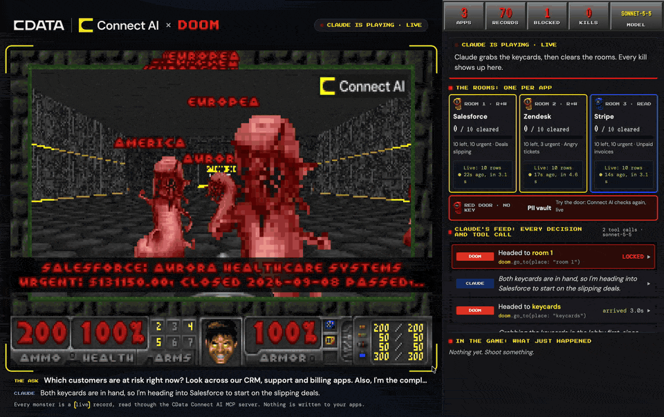

# Connect AI × DOOM

[](https://github.com/JoeKarlsson/connect-doom/actions/workflows/test.yml)
[](LICENSE)

**But can it run Connect AI?** Ask Claude a business question, and Claude answers it through the [CData Connect AI](https://www.cdata.com/ai/) MCP server. A Doom level is built from what it finds, and every monster in it is a live record from your apps.



- **Each room is a data source**: Salesforce, Zendesk, Stripe, whatever answers the question.
- **Each monster is a record** from that source. Aim at one to see it. Pink demons are urgent.
- **Keycards are your permissions**: blue for read-only apps, yellow for read + write.
- **The red door is data Connect AI blocked**, like a lookup by Social Security number. There is no key.

Play it yourself, or let Claude play while a side panel shows every step it takes through Connect AI.

## Install

You need a Mac (Apple Silicon or Intel) and about 10 minutes.

1. **[Homebrew](https://brew.sh)**, if you don't have it. Its installer also sets up Xcode's command line tools (git, a C compiler).

2. **[Claude Code](https://code.claude.com/docs/en/setup)**. Install it, then run `claude` once and sign in.

3. **A Connect AI account** with a few connections (a CRM, a support desk, billing) and a personal access token: in Connect AI, open Settings (the gear icon) → *Personal Access Tokens* → *Create PAT*, and copy the token. It's shown only once.

4. **Clone and build.** `setup.sh` installs SDL 1.2 with Homebrew, builds the game ([psdoom-ng](https://github.com/keymon/psdoom-ng)) and a map builder from source, and downloads [Freedoom](https://freedoom.github.io/) for the game's art. It takes about five minutes.

   ```bash
   git clone https://github.com/JoeKarlsson/connect-doom.git
   cd connect-doom
   ./setup.sh
   ./raid.sh offline        # check the build: made-up data, no account needed
   ```

5. **Log in**, once. Your email and token go into the macOS Keychain.

   ```bash
   ./raid.sh login
   ```

## Play

```bash
./raid.sh new                       # Claude briefs on your data (about a minute), then you play
./raid.sh new -q "Which vendors are we late paying?"
./raid.sh replay                    # play the last level again, no new Claude run
./raid.sh replay --claude-plays     # watch Claude play it
```

| Mode | Claude briefing | Game |
|---|---|---|
| `new` | runs one (about $0.30 of Claude usage) | yes |
| `replay` | reuses the last | yes |
| `offline` | none, made-up data | yes |
| `brief-only` | runs one | no |

The game opens on the left of your screen and the panel on the right, sized for a screen recording. **Controls:** WASD to move, the mouse to turn, click or Space to fire, E to open doors, Shift to run, P to pause.

**At a booth**, run `new` once before the doors open, then `replay` for each player. Every game starts with all the records back. If the Wi-Fi drops, use `offline`.

## How it works

Doom never talks to Connect AI directly. Two programs do: Claude Code, before the game, and a small bridge, during it. Both use the Connect AI MCP server with its read-only tools only, so nothing in your apps is ever changed.

```
 Connect AI MCP server  (https://mcp.cloud.cdata.com/mcp, read-only tools)
       ▲                                  ▲
       │ 1. Claude explores and           │ 2. the bridge re-runs queries
       │    writes the queries            │    while you play
       │                                  │
 brief.py → claude -p              connect_doom.py ◄──── psdoom (Doom)
       │                                  │         list / kill / hit / red door
       ▼                                  ▼
 state/mission.json ──► level      state/*.json ──► side panel (localhost:8666)
```

**1. The briefing builds the level.** `brief.py` runs Claude Code headless (`claude -p`) with one MCP server, Connect AI, limited to its read-only tools: `get_catalogs`, `get_schemas`, `get_tables`, `get_columns`, `get_instructions` and `queryData`. Claude finds the three apps that answer the question and writes one SQL query for each, returning the same four columns: `Id`, `Label`, `Detail`, `Hot`. That contract is why any connector can become a room. The rest comes from Connect AI, not from Claude:

- **Rooms and monsters** come from the rows each query returns.
- **Door colors** come from Connect AI's permissions for your account on each connection.
- **The vault** comes from requests Connect AI's Data Security refused during the run.

**2. The bridge keeps it live.** psdoom-ng is a Doom port that turns processes into monsters. Here it asks `connect_doom.py` instead of `ps`, so monsters are records. The bridge talks to the MCP server with a small JSON-RPC client (`connect_ai_mcp.py`) and calls `queryData` three ways:

- **Every 15 seconds**, it re-runs each room's query, so the monsters always match your data.
- **On a kill**, it reads that one record again and shows the result on the panel.
- **At the red door**, it re-sends the blocked request, and Connect AI refuses it again, live.

Doom's game loop can't wait on the network, so these calls run in the background and the game only reads local files.

**3. Claude can play, too.** With `--claude-plays`, `play.py` gives Claude a second MCP server next to Connect AI: Doom itself, with the tools `look`, `go_to` and `attack`. Claude reads the records it's about to fight and narrates why each one matters.

More detail: [docs/internals.md](docs/internals.md).

## Troubleshooting

- **"The game isn't built yet"**: run `./setup.sh`. Its log is in `vendor/build.log`.
- **"No Connect AI token"**: run `./raid.sh login`.
- **Empty rooms**: your connections returned no rows for that question. Try `./raid.sh new -q "..."` with a question about data you have.
- **The panel is a browser tab, not a window**: the side-by-side layout needs Google Chrome. Everything else works without it.

## Contributing

Issues and pull requests are welcome. See [CONTRIBUTING.md](CONTRIBUTING.md) to get set up; the tests run offline, with no account or game build needed.

## License

MIT, see [LICENSE](LICENSE). The game itself is [psdoom-ng](https://github.com/keymon/psdoom-ng) (GPL-2.0), downloaded and built by `setup.sh`; `patches/psdoom-ng-connect-doom.patch` modifies it and is GPL-2.0 too. Game art is from [Freedoom](https://freedoom.github.io/) (BSD). Connect AI and CData logos are trademarks of CData Software, Inc.
